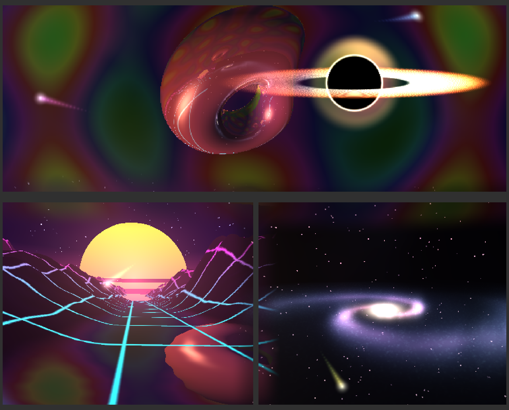
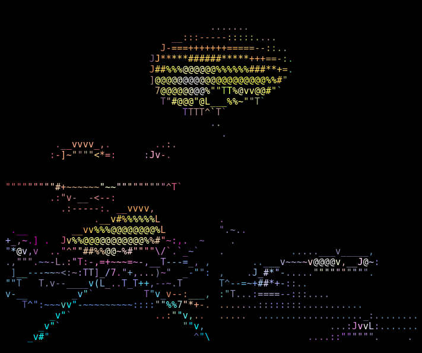

# idle

An idle animation for [herdr](https://herdr.dev) panes: three GPU-rendered
worlds in three panes that behave like windows onto one shared space: a
spinning chrome torus, a synthwave flyover and a volumetric spiral galaxy,
with a black hole drifting across all of them.



On a terminal without image support (e.g. a phone attached to herdr) the same
frames are drawn as shape-matched ASCII:



## How the panes are connected

The three processes never talk to each other. Each one derives the whole scene
from three shared inputs:

- **the clock**: everything that moves is a function of wall time, so all panes
  agree where the black hole, the gravitational-wave pulse and the comets are;
- **the herdr layout**: every 2 s each process asks herdr for the pane
  rectangles and builds one coordinate system for the whole tab;
- **the same shader**: all three worlds live in one WGSL file, so any pane can
  render any world at any tab point.

On top of that: gravitational lensing that bends light *between* worlds (near
the hole you see the neighbouring pane's world), a chrome torus that reflects
the panes beside it, a wet synthwave floor that mirrors the pane above, the
synthwave sun lighting every world, a tab-wide aurora field, and borders that
cross-fade into the neighbour so both sides of each gap meet.

## Output modes

- **GPU images**: frames go to herdr's pane graphics layer (`pane.graphics.set`).
  herdr caps an image at ~512 KB, so frames are sized to fit and scaled up to
  the pane; up to 8 frames are kept in flight to hide herdr's round trip.
- **ASCII**: each cell is rendered as a 4x8 block, reduced to a 2x4 coverage
  pattern; edge cells are matched against glyph outlines (`/ \ | _ ( ) J L 7 T`),
  flat cells use a density ramp, per-pane auto-exposure, 256 colours, and only
  changed cells are sent.

The mode follows the attached terminal automatically (rechecked every 2 s).
`ASCII=1` / `ASCII=0` forces it, `ASCII_COLOR=0` makes ASCII monochrome.

## Running

```sh
cargo build --release
# in three herdr panes (torus, synth, galaxy):
./run.sh torus
./run.sh synth
./run.sh galaxy
```

`WORLD_PANES=w1:p2,w1:p3,w1:p4` names the herdr panes holding the torus, synth
and galaxy worlds (that is the default). Other knobs: `TORUS_SCALE` (render
resolution divisor), `TORUS_INFLIGHT`, `TORUS_LOG=<file>` (fps log),
`TORUS_DUMP=<file>` (writes one raw frame whenever `<file>.req` exists).

On NixOS, `run.sh` finds the 64-bit Vulkan loader in the store and adds the
system Mesa drivers; set `VULKAN_LOADER_LIB` to skip the search.

## Layout

- `src/shader.wgsl`: the three worlds, black hole, reflections, sun, aurora, seams
- `src/main.rs`: GPU setup, herdr layout polling, comets, frame transport
- `src/ascii.rs`: the ASCII converter
- `tools/stitch.py`: stitch frame dumps into one picture laid out like the tab
- `tools/asciishot.py`: screenshot the live ASCII panes (headless Chromium)
- `legacy/`: how it started: `donut.py` (one pane), `scene.py` (three Python
  panes with cross-pane comets) and `go-torus/` (compiled half-block renderer)
